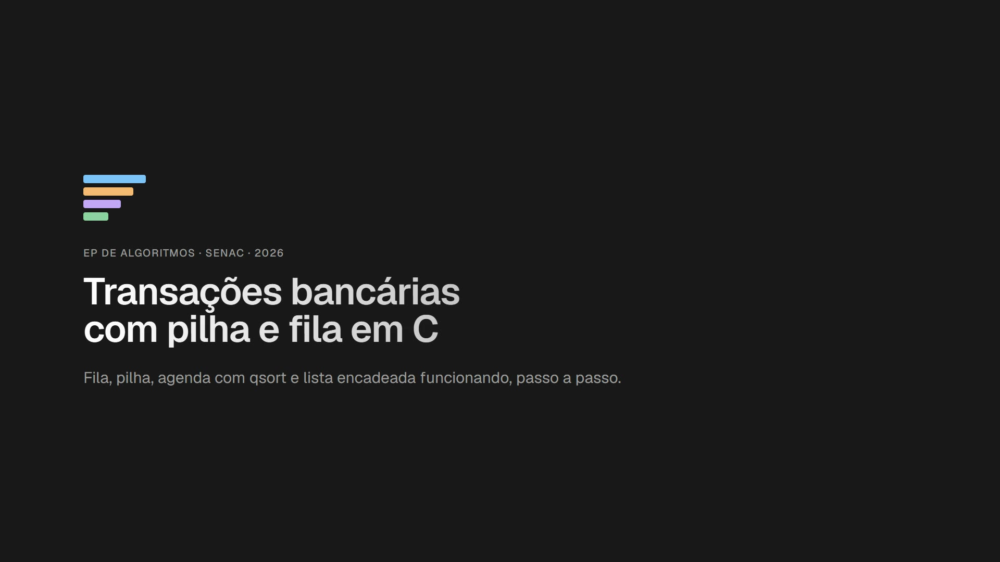

# EP Pilhas e Filas: transações bancárias em C

Projeto acadêmico de Algoritmos que usa **fila, pilha, ordenação e vetores** em um sistema bancário.
Clientes pedem depósito, saque, transferência e pagamento (imediato ou agendado) e podem estornar
a última operação efetivada.

**[Apresentação](https://ep-pilhas-filas.vercel.app/)** ·
**[Simulador interativo](https://ep-pilhas-filas.vercel.app/simulador.html)** ·
**[Vídeo da demonstração](https://ep-pilhas-filas.vercel.app/midia/banco-ep.mp4)**

[](https://ep-pilhas-filas.vercel.app/midia/banco-ep.mp4)

## Como rodar

É preciso ter o `gcc` no `PATH` (no Windows: MinGW/WinLibs).

**Windows (PowerShell):**
```powershell
.\compilar.bat                              # compila o programa e os testes
.\testar.bat                                # roda os testes
.\banco.exe                                 # uso interativo
Get-Content demo\entrada-demo.txt | .\banco.exe   # demonstração automática
```

**Linux/macOS:**
```sh
make && make testes && ./banco
```

## Como as estruturas trabalham juntas

Um pedido imediato entra na **fila**. Ao ser processado, o sistema confere o saldo: se a operação é
efetivada, ela vai para a **pilha de estornos**; se é recusada, não vai. Nos dois casos o resultado fica
no **histórico**. Pagamentos agendados esperam na **agenda ordenada** até a data chegar e **não**
entram na pilha.

| Estrutura | Arquivo | Uso | Custo |
|---|---|---|---|
| **Fila FIFO** (vetor circular) | `src/fila.c` | pedidos imediatos: quem pediu primeiro é atendido primeiro | O(1) |
| **Pilha LIFO** (vetor) | `src/pilha.c` | estorno desfaz a **última** operação efetivada | O(1) |
| **Vetor ordenado por inserção** | `src/agendados.c` | agendados por data; o número de entrada desempata datas iguais | O(n) |
| **Vetor de registros** | `src/historico.c` | um evento por posição, até 1.000 | O(1) |

### Onde estão as operações de pilha e fila

| Operação | Função | Onde é usada |
|---|---|---|
| Enfileirar (entra no fim) | `enfileirar` · `src/fila.c` | `solicitarOperacao` · `src/sistema.c` |
| Desenfileirar (sai o primeiro) | `desenfileirar` · `src/fila.c` | `processarProximo` · `src/sistema.c` |
| Empilhar (novo topo) | `empilhar` · `src/pilha.c` | `processarProximo` (efetivada) e `estornar` (estorno recusado volta ao topo) |
| Desempilhar (sai o topo) | `desempilhar` · `src/pilha.c` | `estornar` · `src/sistema.c` |
| Fila/pilha vazia ou cheia | `filaVazia`, `filaCheia`, `pilhaVazia`, `pilhaCheia` | `sistema.c`, antes de cada operação |
| Inserir ordenado na agenda | `agendar` + `ordenarAgenda` · `src/agendados.c` | `agendarPagamento` · `src/sistema.c` |

O programa não usa ponteiros explícitos nem alocação dinâmica: o estado fica em um `Sistema banco`
global, as funções trabalham com vetores e índices e devolvem `Operacao` por valor
(`numero == 0` indica "nenhuma operação").

## Menu

O programa começa em **05/11/2026** com as contas **1 Ana (R$ 500)**, **2 Bruno (R$ 200)** e **3 Carla (R$ 50)**.

| Opção | Ação |
|---|---|
| 1–4 | Depósito, saque, transferência e pagamento imediato (entram na fila) |
| 5 / 6 | Processa o próximo pedido / a fila inteira |
| 7 | Estorna a última operação efetivada (topo da pilha) |
| 8 / 9 | Agenda / cancela um pagamento futuro |
| 10 | Avança a data e executa os agendados vencidos |
| 11 / 12 | Situação (contas, fila, pilha, agenda) / histórico |
| 0 | Sai |

**Exemplo de FIFO:** peça dois saques da conta 3 (R$ 40 e R$ 30) e processe com a opção 6.
O primeiro é efetivado e o segundo é recusado, porque restam R$ 10. A opção 7 estorna o saque efetivado.

## Como apresentar

Roteiro de 15 minutos: **3 min** de problema, **5 min** de demonstração e **7 min** de perguntas.

1. **Problema (slides 1–4):** abra a [apresentação](https://ep-pilhas-filas.vercel.app/)
   (← / → navegam, **O** mostra a visão geral, **S** abre o simulador).
2. **Demonstração:** rode `.\banco.exe` e faça dois saques da conta 3 (R$ 40 e R$ 30), depois as opções
   `6` (processar a fila), `11` (situação), `7` (estorno), `7` de novo (pilha vazia) e `12` (histórico).
   Mostre `enfileirar`/`desenfileirar` em `src/fila.c` e `empilhar`/`desempilhar` em `src/pilha.c`.
   A agenda aparece na demonstração automática ou no [simulador](https://ep-pilhas-filas.vercel.app/simulador.html).
3. **Perguntas:** o código e os testes ficam abertos para consulta.

Sem `gcc` na máquina da apresentação, o `banco.exe` compilado roda em qualquer Windows 10/11 sem instalação.
Sem internet, os slides abrem localmente com
`python -m http.server 8000 --bind 127.0.0.1 --directory slides`.

## Casos tratados

Pilha vazia ("Nada a estornar"), saldo insuficiente, dois pedidos disputando o mesmo saldo,
agendados com a mesma data, agendamento para hoje ou para o passado, cancelamento de agendado já executado,
**estorno impossível** (o dinheiro já foi gasto), conta inexistente, valor inválido, transferência
para a mesma conta, estruturas cheias e histórico cheio. Entradas inválidas repetem a pergunta.

## Testes

| Conjunto | Comando | Verificações |
|---|---|---|
| C | `.\testar.bat` ou `make testes` | 72, em 4 programas |
| Simulador JS | `node testes/teste_simulador.mjs` | 32 (compara com a saída do `banco.exe`) |
| Terminal | `node testes/teste_terminal.mjs` | 12 (roda o programa compilado) |

## Arquivos

| Caminho | Conteúdo |
|---|---|
| `src/operacao` | struct `Operacao`, a "ficha" de cada operação |
| `src/fila`, `src/pilha` | fila circular e pilha em vetor |
| `src/agendados` | agenda com ordenação por inserção |
| `src/historico` | histórico em vetor |
| `src/sistema` | contas e regras do banco |
| `src/entrada` | leitura validada do teclado (sem `scanf`) |
| `src/main.c` | menu |
| `testes/` | testes em C e JavaScript |
| `demo/` | roteiro da demonstração e saída esperada |
| `slides/` | apresentação, simulador animado e vídeo |
| `processo-ia.md` | diário cronológico do uso de IA: iterações, decisões, testes e commits |
